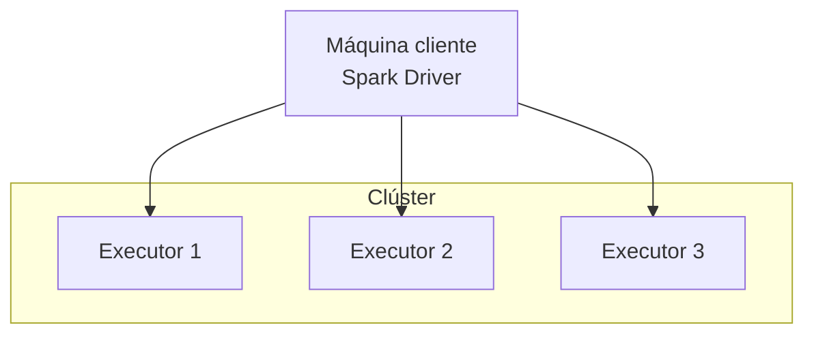
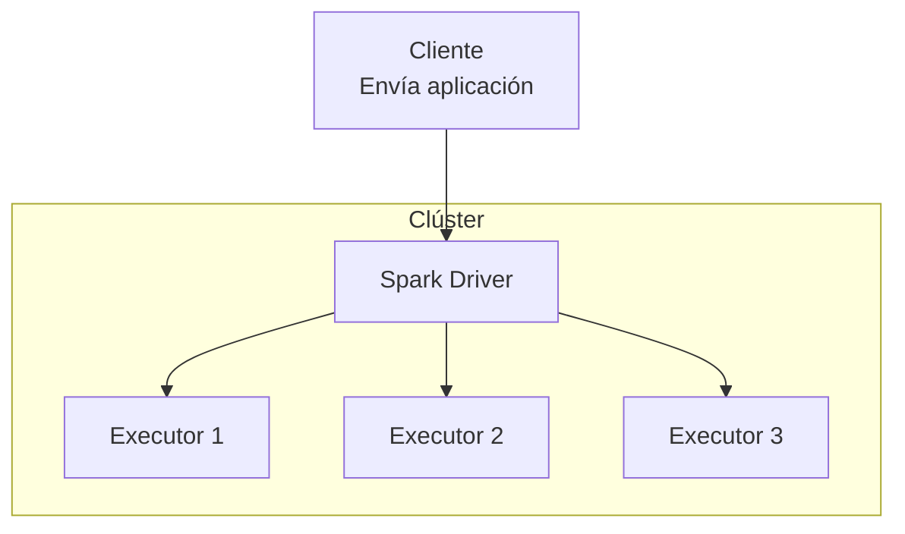
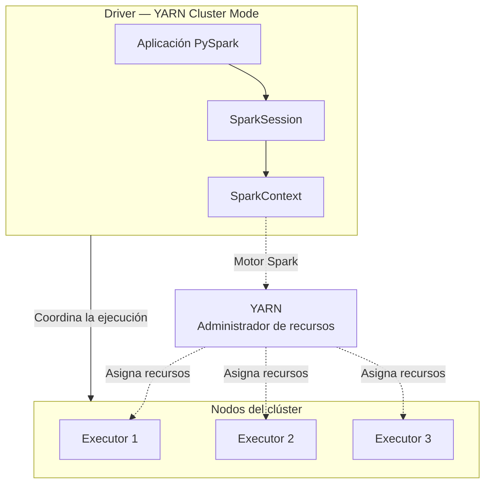
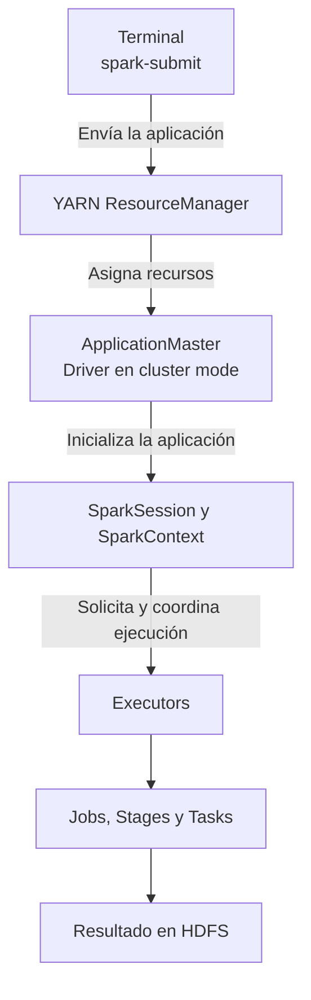

# 04 - Ejecución de aplicaciones Spark

---

## 4.1. Entornos y modos de ejecución de Spark

**Apache Spark** permite ejecutar aplicaciones en diferentes entornos, desde una computadora local hasta clústeres distribuidos con múltiples nodos.

El entorno seleccionado determina cómo se administran los recursos computacionales, mientras que el modo de despliegue determina dónde se ejecuta el proceso Driver.

Para comprender estas configuraciones es necesario distinguir dos conceptos:

- **Master:** indica el entorno o administrador de clúster al que se conecta la aplicación.
- **Deploy Mode:** determina dónde se ejecuta el Driver en los entornos que admiten distintos modos de despliegue.

---

### 4.1.1. Entornos de ejecución

Spark puede ejecutarse utilizando diferentes configuraciones de infraestructura.

| Entorno | Descripción | Ejemplo |
|---|---|---|
| Local | Ejecuta Spark en una sola máquina | `local[*]` |
| Standalone | Utiliza el administrador de clúster integrado en Spark | `spark://host:7077` |
| YARN | Utiliza el administrador de recursos de Hadoop | `yarn` |
| Kubernetes | Ejecuta aplicaciones mediante recursos administrados por Kubernetes | `k8s://...` |

La selección del entorno no cambia los conceptos fundamentales de DataFrames, transformaciones o acciones, aunque puede afectar la configuración, los recursos disponibles y el comportamiento operativo.

---

### 4.1.2. Local Mode

En **Local Mode**, Spark ejecuta la aplicación en una sola máquina.

Es especialmente útil para:

- Aprendizaje y desarrollo.
- Pruebas de código.
- Procesamiento de datasets pequeños.
- Validación de transformaciones antes de ejecutarlas en un clúster.

Ejemplo:

```python
from pyspark.sql import SparkSession

spark = (
    SparkSession.builder
    .master("local[*]")
    .appName("LocalSparkApp")
    .getOrCreate()
)
```

El parámetro:

```python
.master("local[*]")
```

indica que Spark puede utilizar los procesadores lógicos disponibles en la máquina local para ejecutar tasks.

También es posible especificar un número concreto:

```python
.master("local[4]")
```

Esto configura Spark para utilizar hasta cuatro hilos de ejecución de tasks en modo local.

> **Importante:** Local Mode no representa un clúster distribuido de múltiples máquinas. Permite experimentar con el modelo de ejecución de Spark utilizando recursos locales.

---

### 4.1.3. Modos de despliegue

Cuando Spark se ejecuta en un clúster, es importante distinguir los modos de despliegue.

---

#### Client Mode

En Client Mode, el Driver se ejecuta en el proceso que inicia la aplicación.

Los executors pueden ejecutarse en nodos remotos del clúster.



Este modo puede ser útil en escenarios interactivos, donde el usuario necesita mantener una relación directa con el proceso Driver.

---

#### Cluster Mode

En Cluster Mode, el Driver se ejecuta dentro de la infraestructura del clúster.



Este modo suele utilizarse para aplicaciones batch y procesos automatizados.

La diferencia principal es la ubicación del Driver, no la definición de las operaciones sobre los datos.

La disponibilidad de cada modo depende del administrador de clúster y del tipo de aplicación.

---

### 4.1.4. Parámetros Master vs. Deploy Mode

Los parámetros `master` y `deploy-mode` responden a preguntas diferentes.

| Parámetro | Pregunta | Ejemplo |
|---|---|---|
| `master` | ¿Dónde se ejecutará la aplicación? | `yarn` |
| `deploy-mode` | ¿Dónde se ejecutará el Driver? | `cluster` |

Por ejemplo:

```bash
spark-submit \
  --master yarn \
  --deploy-mode cluster \
  app.py
```

Este comando solicita ejecutar la aplicación mediante YARN y ubicar el Driver dentro del clúster.

En cambio:

```bash
spark-submit \
  --master yarn \
  --deploy-mode client \
  app.py
```

Utiliza el mismo administrador de recursos, pero mantiene el Driver en el proceso cliente.

---

### 4.1.5. ¿Qué entorno utilizar?

La elección depende del objetivo y de la infraestructura disponible.

| Escenario | Entorno habitual |
|---|---|
| Aprender PySpark | Local |
| Desarrollar transformaciones | Local o entorno de desarrollo |
| Ejecutar procesos en Hadoop | YARN |
| Ejecutar Spark en Kubernetes | Kubernetes |
| Mantener un clúster dedicado a Spark | Standalone |
| Ejecutar pipelines productivos | Entorno distribuido administrado |

Para comenzar a programar con PySpark, **Local Mode es suficiente**.

Permite practicar DataFrames, SQL, transformaciones, acciones y lectura de archivos sin necesidad de configurar un clúster de múltiples máquinas.

---

### 4.1.6. Ideas clave

> 1. Spark puede ejecutarse localmente o en clústeres distribuidos.
> 2. El parámetro `master` selecciona el entorno de ejecución.
> 3. El parámetro `deploy-mode` determina la ubicación del Driver cuando el entorno admite esa elección.
> 4. En **Client Mode**, el Driver permanece en el proceso cliente.
> 5. En **Cluster Mode**, el Driver se ejecuta dentro del clúster.
> 6. **Local Mode** es adecuado para aprender y desarrollar aplicaciones PySpark.
> 7. La arquitectura lógica de Spark conserva sus conceptos fundamentales independientemente del entorno utilizado.

---

## 4.2. SparkSession y SparkContext

**Apache Spark** proporciona diferentes interfaces para interactuar con su motor de procesamiento distribuido. Entre las más importantes se encuentran **SparkSession** y **SparkContext**.

Ambos son objetos de programación utilizados dentro de una aplicación Spark, pero cumplen responsabilidades diferentes:

- **SparkSession:** punto de entrada principal para trabajar con DataFrames, Spark SQL y catálogos.
- **SparkContext:** proporciona acceso al contexto de ejecución de Spark y a funcionalidades de bajo nivel, principalmente la API de RDD.

En aplicaciones modernas de PySpark, normalmente se utiliza `SparkSession`, desde la cual también es posible acceder al `SparkContext` asociado.

### 4.2.1. SparkSession

**SparkSession** es el punto de entrada principal para el procesamiento de datos estructurados en Apache Spark.

Permite crear DataFrames, leer fuentes de datos, ejecutar consultas SQL y acceder a los metadatos de tablas y bases de datos.

#### Creación de una SparkSession

```python
from pyspark.sql import SparkSession

spark = (
    SparkSession.builder
    .appName("CustomerAnalysis")
    .enableHiveSupport()
    .getOrCreate()
)
```

En este ejemplo:

| Método | Función |
|---|---|
| `SparkSession.builder` | Permite configurar la sesión |
| `appName()` | Define el nombre de la aplicación |
| `enableHiveSupport()` | Habilita la integración con Hive cuando el entorno está configurado |
| `getOrCreate()` | Recupera una sesión existente o crea una nueva |

**Nota:** cuando la aplicación se envía mediante `spark-submit --master yarn`, no es necesario volver a establecer `master("yarn")` dentro del código.

Es preferible definir el entorno de ejecución y los recursos del clúster mediante `spark-submit`, dejando que `SparkSession` proporcione acceso a las funcionalidades de procesamiento.

#### Funcionalidades principales

| Método o propiedad | Descripción |
|---|---|
| `spark.read` | Leer datos desde archivos y otras fuentes |
| `spark.sql()` | Ejecutar consultas SQL |
| `spark.table()` | Acceder a tablas del catálogo |
| `spark.createDataFrame()` | Crear DataFrames |
| `spark.catalog` | Consultar metadatos de tablas y bases de datos |
| `spark.conf` | Consultar o modificar configuraciones de sesión |
| `spark.sparkContext` | Acceder al SparkContext asociado |
| `spark.stop()` | Detener el contexto de ejecución asociado |

#### Ejemplo: consultar una tabla Hive

```python
df = spark.table("telecom.customers")

result = (
    df.groupBy("region")
      .count()
)

result.show()
```

En este ejemplo, `SparkSession` permite acceder a una tabla registrada en el catálogo y utilizar la API de DataFrames.

Spark se encarga de planificar y distribuir el procesamiento entre los executors disponibles.

### 4.2.2. SparkContext

**SparkContext** representa la conexión fundamental de una aplicación con el entorno de ejecución de Spark.

Proporciona acceso a las funcionalidades de bajo nivel del motor, especialmente a los **RDD (Resilient Distributed Datasets)**.

En PySpark moderno, normalmente se obtiene desde una `SparkSession`:

```python
sc = spark.sparkContext
```

#### Funcionalidades principales

| Método o propiedad | Descripción |
|---|---|
| `sc.parallelize()` | Crear un RDD a partir de una colección local |
| `sc.textFile()` | Crear un RDD desde archivos de texto |
| `sc.broadcast()` | Distribuir una variable de solo lectura |
| `sc.accumulator()` | Crear un acumulador mediante la API clásica |
| `sc.getConf()` | Consultar configuraciones del contexto |
| `sc.applicationId` | Obtener el identificador de la aplicación |
| `sc.defaultParallelism` | Consultar el paralelismo predeterminado |
| `sc.stop()` | Detener el contexto de ejecución |

#### Ejemplo: procesamiento mediante RDD

```python
sc = spark.sparkContext

rdd = sc.parallelize(
    [10, 20, 30, 40, 50],
    4
)

result = (
    rdd.filter(lambda x: x > 20)
       .map(lambda x: x * 2)
       .collect()
)

print(result)
```

Resultado:

```text
[60, 80, 100]
```

El método `parallelize()` crea un RDD distribuido en cuatro particiones.

Las transformaciones `filter()` y `map()` se evalúan de manera diferida, mientras que `collect()` desencadena la ejecución y devuelve los resultados al Driver.

**Importante:** el uso de `sc.parallelize()` con colecciones locales es principalmente ilustrativo. En aplicaciones productivas, normalmente se procesan datos provenientes de sistemas distribuidos mediante DataFrames.

### 4.2.3. Relación entre SparkSession, SparkContext y Driver

Aunque están relacionados, estos tres componentes no representan lo mismo.

| Componente | Tipo | Responsabilidad |
|---|---|---|
| **Driver** | Proceso | Coordina la aplicación y su ejecución distribuida |
| **SparkContext** | Objeto de API | Proporciona acceso al contexto de ejecución y a los RDD |
| **SparkSession** | Objeto de API | Proporciona acceso a DataFrames, Spark SQL y catálogos |

#### Relación arquitectónica



El diagrama es conceptual: en PySpark, el proceso Python del Driver interactúa con componentes de Spark implementados en la JVM, que participan en la planificación y coordinación de la ejecución.

En YARN cluster mode, el Driver se ejecuta dentro del clúster. Los executors se ejecutan en containers asignados por YARN.

#### ¿Pueden existir varias SparkSessions?

Sí. Es posible crear sesiones adicionales mediante:

```python
spark2 = spark.newSession()
```

Estas sesiones pueden mantener configuraciones SQL y vistas temporales independientes, pero comparten el mismo `SparkContext` y los recursos subyacentes de ejecución.

Por lo tanto, **crear una nueva SparkSession no significa iniciar una nueva aplicación Spark**.

### 4.2.4. SparkSession vs. SparkContext

| Característica | SparkSession | SparkContext |
|---|---|---|
| Nivel de abstracción | Alto nivel | Bajo nivel |
| API principal | DataFrames y SQL | RDD |
| Consultas SQL | Sí | No directamente |
| Acceso a catálogos | Sí | No directamente |
| Variables broadcast | Mediante SparkContext | Sí |
| Uso habitual | Procesamiento estructurado | Operaciones específicas de bajo nivel |

En la mayoría de las aplicaciones modernas de PySpark, **SparkSession es la interfaz principal**, mientras que SparkContext se utiliza cuando se necesitan funcionalidades específicas de bajo nivel.

> **SparkSession** proporciona la interfaz de procesamiento estructurado, **SparkContext** permite acceder a las funcionalidades fundamentales del motor y el **Driver** coordina la ejecución de la aplicación en el clúster.

### 4.2.5. Ideas clave

> 1. **SparkSession** es el punto de entrada principal para DataFrames, Spark SQL y catálogos.
> 2. **SparkContext** proporciona acceso al contexto de ejecución y a la API de RDD.
> 3. El **Driver** es el proceso que coordina la aplicación; SparkSession y SparkContext son objetos de programación.
> 4. En PySpark moderno, SparkContext se obtiene mediante `spark.sparkContext`.
> 5. Varias SparkSessions pueden compartir un mismo SparkContext.
> 6. En aplicaciones sobre YARN, es recomendable definir el entorno de despliegue y los recursos mediante `spark-submit`.
> 7. SparkSession permite trabajar con los datos sin administrar directamente los executors, las tasks o la distribución física del procesamiento.

## 4.3. spark-submit: envío y despliegue de aplicaciones

**`spark-submit`** es la herramienta de línea de comandos utilizada para enviar aplicaciones Apache Spark a un entorno de ejecución.

Permite indicar dónde se ejecutará una aplicación, cómo se desplegará el Driver, qué archivo contiene el código principal y qué configuraciones o dependencias necesita.

En un entorno administrado por **Apache Hadoop YARN**, `spark-submit` permite solicitar el inicio de una aplicación Spark dentro del clúster.

### 4.3.1. ¿Qué es spark-submit?

`spark-submit` es el mecanismo estándar para iniciar el despliegue de aplicaciones Spark desde una terminal, un script de automatización o un sistema de orquestación.

Sus principales responsabilidades son:

- Identificar el archivo principal de la aplicación.
- Seleccionar el administrador de recursos.
- Definir el modo de despliegue.
- Proporcionar configuraciones y dependencias.
- Iniciar el proceso de envío de la aplicación.

**Importante:** `spark-submit` no es el Driver, ni un executor, ni el motor que ejecuta directamente las transformaciones.

Es la herramienta que prepara e inicia el despliegue de la aplicación.

### 4.3.2. Estructura de un comando spark-submit

La estructura general es:

```bash
spark-submit \
  [opciones] \
  archivo_principal.py \
  [argumentos_de_la_aplicacion]
```

Para una aplicación PySpark sobre YARN:

```bash
spark-submit \
  --master yarn \
  --deploy-mode cluster \
  --name CustomerAnalysis \
  customer_analysis.py
```

| Elemento | Función |
|---|---|
| `spark-submit` | Inicia el proceso de envío |
| `--master yarn` | Selecciona YARN como administrador de recursos |
| `--deploy-mode cluster` | Ejecuta el Driver dentro del clúster |
| `--name CustomerAnalysis` | Establece el nombre de la aplicación |
| `customer_analysis.py` | Archivo Python principal |

El archivo Python contiene la lógica de procesamiento que se ejecutará una vez iniciada la aplicación.

### 4.3.3. Envío de aplicaciones PySpark a YARN

Supongamos que tenemos una aplicación llamada `customer_analysis.py`.

```python
from pyspark.sql import SparkSession
from pyspark.sql import functions as F

spark = (
    SparkSession.builder
    .appName("CustomerAnalysis")
    .enableHiveSupport()
    .getOrCreate()
)

customers = spark.table("telecom.customers")

result = (
    customers
    .filter(F.col("status") == "ACTIVE")
    .groupBy("region")
    .agg(F.count("*").alias("total_customers"))
)

result.write.mode("overwrite").parquet(
    "hdfs:///data/analytics/customers_by_region"
)

spark.stop()
```

La aplicación realiza las siguientes operaciones:

1. Crea o recupera una `SparkSession`.
2. Accede a una tabla registrada en el catálogo de Hive.
3. Filtra los clientes activos.
4. Agrupa los registros por región.
5. Calcula el número de clientes por región.
6. Escribe los resultados en HDFS.

Para enviarla al clúster:

```bash
spark-submit \
  --master yarn \
  --deploy-mode cluster \
  --name CustomerAnalysis \
  customer_analysis.py
```

**¿Qué ocurre después del envío?**



En YARN cluster mode, el Driver se ejecuta dentro del proceso ApplicationMaster de la aplicación Spark.

Los executors se ejecutan en containers asignados por YARN y realizan el procesamiento distribuido.

### 4.3.4. Client Mode vs. Cluster Mode

El parámetro `--deploy-mode` determina dónde se ejecuta el Driver.

#### Client Mode

```bash
spark-submit \
  --master yarn \
  --deploy-mode client \
  customer_analysis.py
```

En este modo:

- El Driver se ejecuta en el entorno desde el que se envía la aplicación.
- YARN administra los recursos del clúster.
- Los executors se ejecutan en los nodos del clúster.
- El entorno del Driver debe mantener conectividad con los executors.

Es útil para desarrollo, depuración y determinados entornos interactivos.

#### Cluster Mode

```bash
spark-submit \
  --master yarn \
  --deploy-mode cluster \
  customer_analysis.py
```

En este modo:

- El Driver se ejecuta dentro del clúster.
- YARN administra la asignación de recursos.
- Los executors se ejecutan en containers de YARN.
- El proceso que envía la aplicación no necesita permanecer ejecutando el Driver.

Suele utilizarse para aplicaciones batch y procesos productivos.

| Característica | Client Mode | Cluster Mode |
|---|---|---|
| Ubicación del Driver | Entorno cliente | Clúster YARN |
| Executors | Clúster | Clúster |
| Uso frecuente | Desarrollo y depuración | Procesos batch y productivos |
| Dependencia del cliente para ejecutar el Driver | Sí | No |
| Administrador de recursos | YARN | YARN |

Ambos modos pueden ejecutar procesamiento distribuido. La diferencia principal es la ubicación del Driver, no la capacidad de Spark para distribuir tareas.

### 4.3.5. Archivos y dependencias de una aplicación

Una aplicación PySpark puede necesitar archivos adicionales, módulos Python, configuraciones o bibliotecas externas.

`spark-submit` proporciona opciones para distribuir estos recursos.

| Parámetro | Función |
|---|---|
| `--py-files` | Distribuir módulos Python en formatos compatibles, como `.py`, `.zip` o `.egg` |
| `--files` | Distribuir archivos auxiliares |
| `--archives` | Distribuir y extraer archivos comprimidos |
| `--jars` | Añadir bibliotecas Java o Scala |
| `--packages` | Resolver dependencias JVM mediante coordenadas Maven |

Por ejemplo, si tenemos:

```text
customer_project/
├── customer_analysis.py
├── utils.zip
└── config.json
```

Podemos enviar la aplicación mediante:

```bash
spark-submit \
  --master yarn \
  --deploy-mode cluster \
  --py-files utils.zip \
  --files config.json \
  customer_analysis.py
```

De esta manera, Spark distribuye los archivos especificados a los entornos correspondientes.

Los módulos Python incluidos en `utils.zip` pueden importarse desde la aplicación si están correctamente estructurados.

> **Nota:** `--py-files` no instala automáticamente todas las dependencias externas de Python. Las bibliotecas con componentes nativos pueden requerir un entorno Python preparado y distribuido mediante otros mecanismos, como `--archives`.

### 4.3.6. Argumentos de la aplicación

Además de las opciones propias de Spark, es posible proporcionar argumentos al script Python.

Ejemplo:

```bash
spark-submit \
  --master yarn \
  --deploy-mode cluster \
  customer_analysis.py \
  --date 2026-10-10 \
  --region NORTH
```

Los argumentos colocados después del archivo principal pertenecen a la aplicación.

Podemos recibirlos mediante `argparse`:

```python
import argparse

parser = argparse.ArgumentParser()

parser.add_argument("--date", required=True)
parser.add_argument("--region", required=True)

args = parser.parse_args()

print(args.date)
print(args.region)
```

Esto permite ejecutar una misma aplicación con diferentes parámetros sin modificar su código.

Por ejemplo, un proceso diario puede recibir una fecha de procesamiento específica desde un scheduler.

### 4.3.7. Ejemplo completo de ejecución

Consideremos una aplicación batch que procesa clientes de telecomunicaciones.

**Archivo:** `customer_analysis.py`

```python
import argparse

from pyspark.sql import SparkSession
from pyspark.sql import functions as F

parser = argparse.ArgumentParser()
parser.add_argument("--date", required=True)
args = parser.parse_args()

spark = (
    SparkSession.builder
    .appName("CustomerAnalysis")
    .enableHiveSupport()
    .getOrCreate()
)

customers = spark.table("telecom.customers")

result = (
    customers
    .filter(F.col("process_date") == args.date)
    .groupBy("region")
    .agg(
        F.count("*").alias("total_customers")
    )
)

result.write.mode("overwrite").parquet(
    f"hdfs:///data/analytics/customers/{args.date}"
)

spark.stop()
```

**Envío mediante spark-submit:**

```bash
spark-submit \
  --master yarn \
  --deploy-mode cluster \
  --name CustomerAnalysis \
  --num-executors 4 \
  --executor-cores 2 \
  --executor-memory 4G \
  --driver-memory 2G \
  customer_analysis.py \
  --date 2026-10-10
```

En este ejemplo:

- `spark-submit` inicia la aplicación sobre YARN.
- YARN administra la asignación de recursos solicitados.
- El Driver ejecuta el código principal de PySpark.
- `SparkSession` proporciona acceso a la tabla y a la API de DataFrames.
- Los executors procesan las particiones de datos.
- El resultado se almacena en HDFS.

> **En resumen:** `spark-submit` permite iniciar una aplicación PySpark y definir cómo se desplegará sobre YARN, mientras que **SparkSession** y **SparkContext** proporcionan las interfaces necesarias para interactuar con el motor de procesamiento distribuido.


### 4.3.8. Ideas clave

> 1. **`spark-submit`** es la herramienta estándar para enviar aplicaciones Spark.
> 2. `--master yarn` indica que YARN administrará los recursos.
> 3. `--deploy-mode` determina dónde se ejecutará el Driver.
> 4. En Client Mode, el Driver se ejecuta en el entorno cliente.
> 5. En Cluster Mode, el Driver se ejecuta dentro del clúster.
> 6. El archivo principal contiene el código de la aplicación PySpark.
> 7. `--py-files`, `--files` y `--archives` permiten distribuir diferentes tipos de dependencias.
> 8. Los argumentos posteriores al archivo principal se entregan a la aplicación.
> 9. `spark-submit` inicia el despliegue; `SparkSession` proporciona la interfaz para trabajar con Spark desde el código.
> 10. Los recursos solicitados mediante `spark-submit` dependen de la disponibilidad y las políticas de YARN.